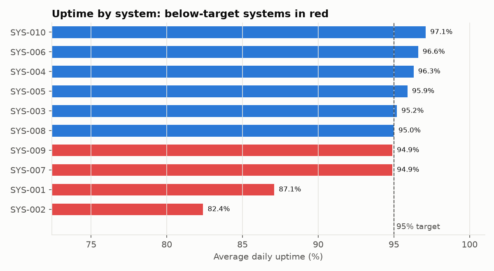
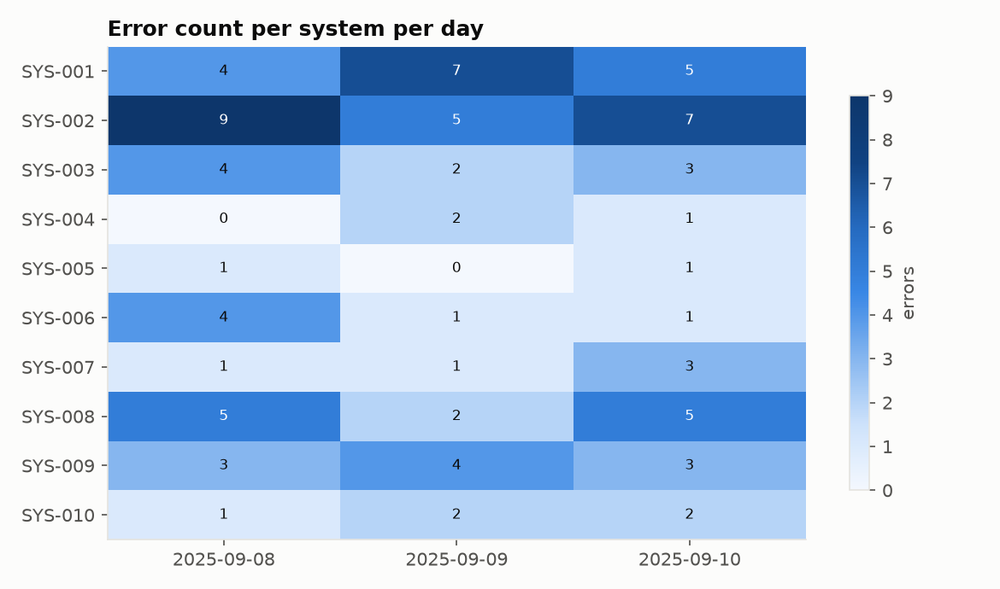
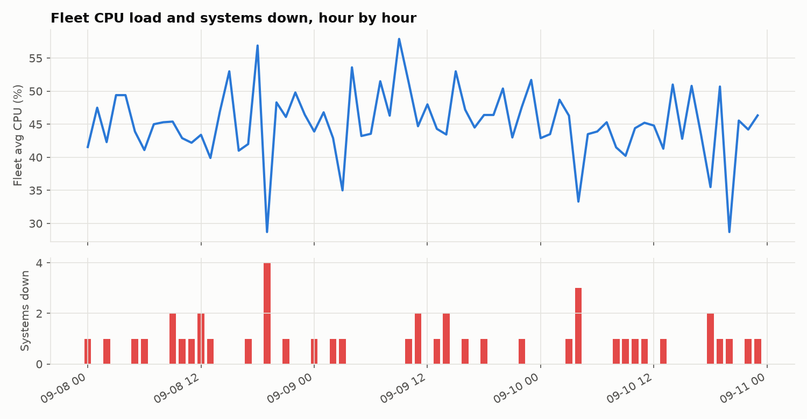

# Telemetry Wrangling Pipeline

A Python + pandas pipeline that turns a folder of messy hourly machine logs into
clean KPI tables you can drop straight into Power BI, Tableau or SQL.

I built this to practise the day-to-day of a data-wrangling role: collecting raw
exports, cleaning them, joining in reference data, checking quality and
publishing numbers a manager can trust. The logs are simulated, but they're
generated to be messy in the same ways real exports are.



## What it does

```
data/raw_logs/*.csv ──► COLLECT ──► CLEAN ──► ENRICH ──► VALIDATE ──► TRANSFORM ──► STORE
  72 hourly files        concat     types,    join        quarantine    daily KPIs    CSV, SQLite,
  (one per hour)                    dedupe,   owners      bad rows      per system    charts,
                                    ranges                              & manager     quality report
```

| Step | What happens |
|---|---|
| **Collect** | Reads every `raw_logs_*.csv` as text, so the pipeline decides the types instead of pandas guessing them |
| **Clean** | Parses `"45%"` → `45`, normalises `" up "` → `UP`, nulls CPU readings outside 0-100, clips uptime over 60 min/hour, removes double-sent records |
| **Enrich** | Joins each system to the manager who owns it (`data/system_owners.csv`) |
| **Validate** | Moves rows with unparseable timestamps or unknown systems into `quarantine.csv` so they never silently skew a KPI |
| **Transform** | Rolls hourly rows up to daily uptime %, average/peak CPU, hours down and error counts |
| **Store** | Writes CSVs, a SQLite database, PNG charts and a Markdown data-quality report |

## Data quality: what the latest run fixed

From [`outputs/data_quality_report.md`](outputs/data_quality_report.md):

| Issue | Rows affected | Action |
|---|---:|---|
| Exact / near duplicates | 60 | dropped (kept first) |
| CPU stored as text (`45%`) | 22 | parsed to number |
| Status casing / whitespace | 84 | normalised to UP / DOWN |
| CPU outside 0-100 | 12 | set to null, excluded from averages |
| Uptime over 60 min/hour | 8 | clipped to 60 |
| Uptime missing | 10 | excluded from uptime % |
| Logs from systems with no owner | 3 | quarantined |

783 raw rows → 720 clean rows (10 systems × 72 hours, exactly one row per system per hour).

## Results

The simulator secretly makes two systems "flaky". The pipeline surfaces them without being told:

| Manager | Avg uptime | Errors | Hours down |
|---|---:|---:|---:|
| Ben (SYS-002) | 82.4% | 21 | 18 |
| Ava (SYS-001) | 87.1% | 16 | 14 |
| ...everyone else | 94.9-97.1% | 2-12 | 0-3 |

| Errors per system per day | Fleet load hour by hour |
|---|---|
|  |  |

## Run it

```bash
git clone https://github.com/kammy04/telemetry-wrangling-pipeline.git
cd telemetry-wrangling-pipeline
pip install -r requirements.txt

python simulate.py            # optional: regenerate logs (--days 7 --systems 25 --seed 7)
python wrangle.py             # writes everything to outputs/
pytest -q                     # 5 tests covering cleaning, validation and KPI maths

sqlite3 outputs/telemetry.db < sql/example_queries.sql
```

## Outputs

| File | Grain | Use it for |
|---|---|---|
| `kpis_by_system.csv` | system × day | uptime %, avg/peak CPU, hours down, errors |
| `kpis_by_manager.csv` | manager × day | the manager scorecard |
| `error_heatmap.csv` | system × day | error counts in a matrix |
| `error_breakdown.csv` | system × error code | which errors each system throws |
| `clean_logs.csv` | system × hour | the cleaned row-level data |
| `quarantine.csv` | row | rejected rows plus the reason |
| `telemetry.db` | - | all of the above in SQLite (see `sql/example_queries.sql`) |

### Building a dashboard

**Power BI:** Get Data → Text/CSV → `kpis_by_system.csv` and `kpis_by_manager.csv`. Add a card
(average `uptime_pct`), a bar chart (errors by `system_id`), a line chart (average `avg_cpu` by `date`)
and a slicer on `manager_name`.

**Tableau:** Connect → Text file → `kpis_by_system.csv`. Put `date` on Columns and `AVG(uptime_pct)`
on Rows, then add `manager_name` as a filter and colour by `system_id`.

## Design decisions

- **Read everything as text first.** Mixed types (`45` vs `"45%"`) are the most common way pandas
  silently turns a numeric column into `object`. Parsing explicitly makes every conversion countable.
- **Null bad readings rather than drop the row.** A 140% CPU reading is a sensor glitch, but that
  hour's uptime and status are still valid.
- **Uptime % uses only hours that reported uptime.** A missing reading shouldn't count as downtime.
- **Quarantine, don't delete.** Unknown systems usually mean the owners table is out of date, and
  someone needs to see them.

## Project layout

```
├── simulate.py          # generates data/raw_logs + data/system_owners.csv
├── wrangle.py           # the pipeline
├── charts.py            # matplotlib charts
├── sql/                 # example queries against telemetry.db
├── tests/               # pytest suite
├── data/                # raw inputs
└── outputs/             # generated tables, charts, report
```

**Tech:** Python · pandas · matplotlib · SQLite · pytest
